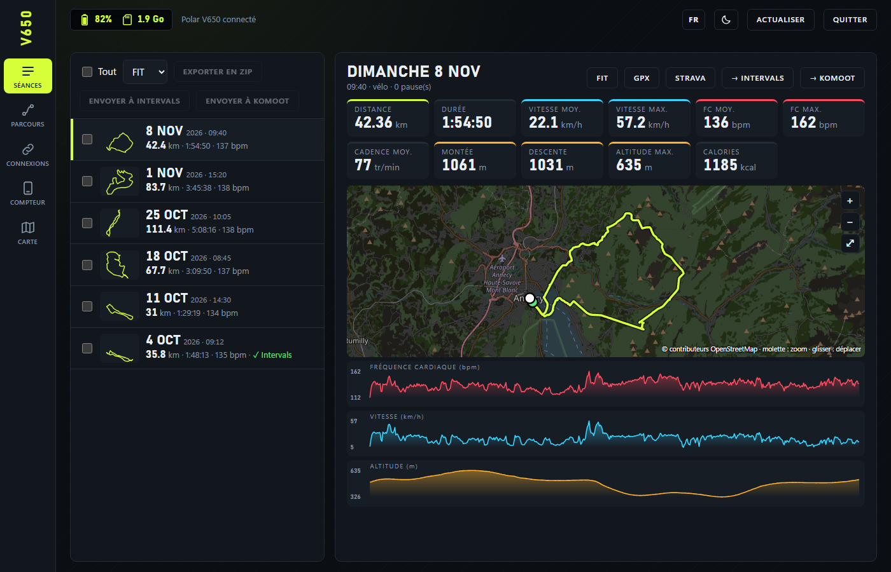
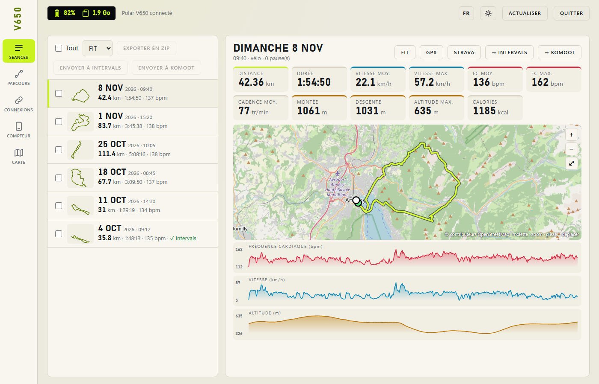
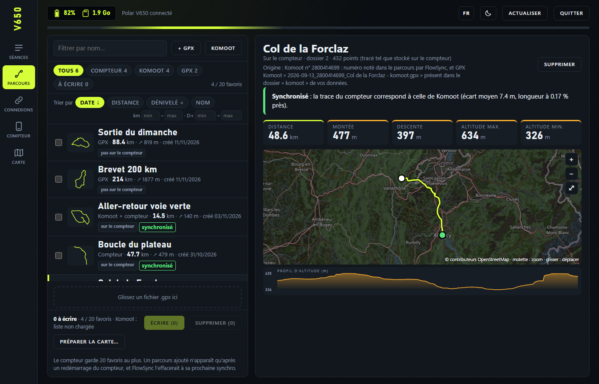
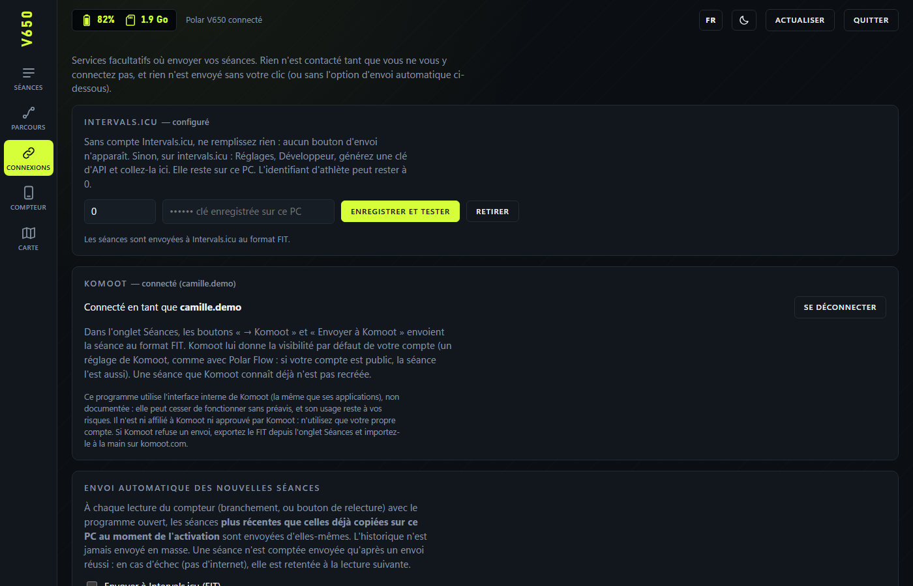
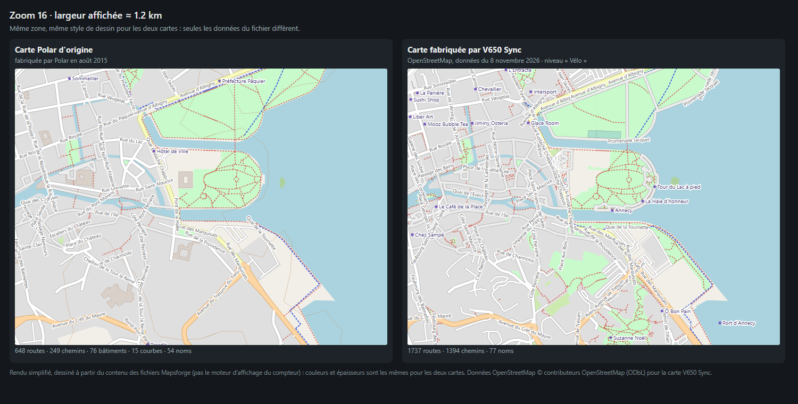
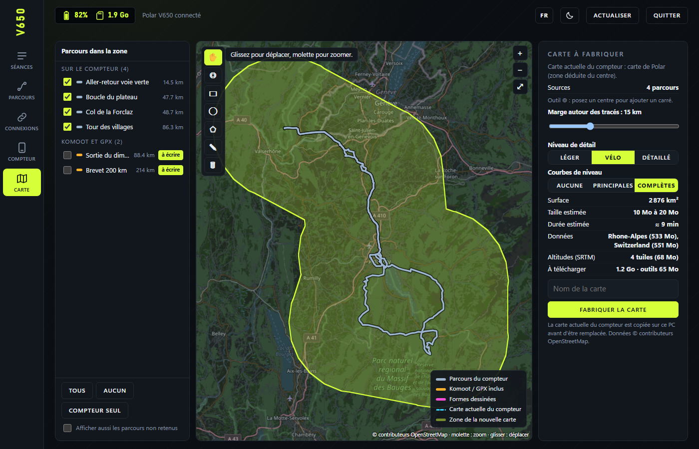

🇬🇧 [English version](README.md)

# V650 Sync

**Application Windows libre et non officielle pour synchroniser un Polar V650 : séances et parcours, sans compte et sans service Bonjour. En prime, elle fabrique des cartes hors ligne à jour.**

V650 Sync est une application de bureau pour Windows 10 et 11 (un seul fichier `.exe` qui ouvre une fenêtre). Elle lit les séances du compteur branché en USB, exporte en FIT et GPX, envoie les séances à Intervals.icu et à Komoot, gère les parcours (GPX ou Komoot) et, dans un second temps, fabrique et installe des cartes hors ligne à partir des données OpenStreetMap actuelles. L'interface existe en français et en anglais, et suit le réglage d'unités du compteur (km ou miles).

> ## ⚠️ Avertissement : utilisation sous votre responsabilité
>
> Cette application est le résultat d'une **rétro-ingénierie non officielle** du protocole du Polar V650. Elle **écrit dans la mémoire du compteur** (parcours, carte hors ligne, heure).
>
> - Elle n'a été **testée que sur un seul Polar V650 (micrologiciel 1.5.5), avec Windows 11 Pro version 26H2 (build 26300)**. Sur un autre exemplaire, une autre version du micrologiciel ou un autre Windows (Windows 10 compris), elle peut mal se comporter.
> - Elle est fournie **« telle quelle », sans aucune garantie** d'aucune sorte (voir la licence GPL-3.0, articles 15 et 16).
> - **Les auteurs et contributeurs déclinent toute responsabilité** pour tout dommage lié à son utilisation : perte de données, compteur qui ne démarre plus ou ne fonctionne plus correctement (« briqué »), perte de garantie, ou tout autre préjudice.
> - L'application copie le compteur sur votre PC avant d'y écrire, mais **il n'y a pas de restauration automatique** : une sauvegarde ne garantit pas que le compteur puisse être remis dans son état d'origine.
> - Aucune écriture n'a lieu sans une action de votre part (bouton « Écrire », « Mettre à jour », etc.), et chacune demande une confirmation.
>
> **Si vous n'acceptez pas ces conditions, n'utilisez pas cette application.**
>
> Ce projet est **indépendant** : il n'est ni affilié à Polar, Komoot, Strava ou Intervals.icu, ni approuvé par eux. « Polar », « V650 » et « FlowSync » sont des marques de leurs propriétaires.

## Pourquoi

Le V650 (2014) ne se synchronise sur PC qu'avec **Polar FlowSync**, qui dépend du service **Bonjour** d'Apple : sous Windows 10 et 11, il est souvent absent ou refusé. Je n'ai pas réussi à synchroniser par Bluetooth avec l'application mobile de Polar. Ce projet est né de là : obtenir une synchronisation **plus fiable et plus performante** du compteur, sur un Windows actuel.

Cette liberté a eu un bénéfice : une fois le protocole compris, il devenait possible de remplacer aussi les **cartes hors ligne** que Polar installe, qui datent de 2015 (voir [plus bas](#cartes-hors-ligne-un-bénéfice-de-la-synchronisation)).

## Captures d'écran

Les captures ci-dessous ont été faites avec des **données fictives**.

**Séances** : liste avec miniatures, chiffres clés, carte et courbes (thème sombre ; le thème clair existe aussi).




**Parcours** : compteur, Komoot et fichiers GPX dans une seule liste, avec le statut « synchronisé ».



**Connexions** : Intervals.icu et Komoot (envoi des séances), envoi automatique et Strava ; l'onglet [Compteur](docs/captures/compteur.png) a aussi sa capture.



## Ce que fait l'application

- **Séances** : copie des séances au branchement, détail (tracé, courbes), export FIT et GPX, envoi à Intervals.icu et à Komoot (manuel, ou automatique pour les nouvelles séances si vous activez l'option ; sur Komoot, la séance prend la visibilité par défaut de votre compte).
- **Parcours** : une seule bibliothèque pour les parcours du compteur, ceux de Komoot (votre compte) et vos fichiers GPX, avec comparaison des traces (« synchronisé / non synchronisé »), tri et filtres ; écriture, mise à jour et suppression sur le compteur.
- **Compteur** : à qui il appartient (nom, e-mail et identifiant Polar, lus sur le compteur et affichés uniquement sur votre PC), batterie et espace libre, profil enregistré dans le compteur, et horloge (mise à l'heure du PC en un clic).
- **Langue et unités** : français ou anglais (suit Windows par défaut), et unités qui suivent le réglage du compteur, indépendamment de la langue (interface en anglais avec km et km/h, ou en français avec des miles, comme vous l'utilisez).
- **Avis de mise à jour** : une fois par jour, une seule requête anonyme vers GitHub indique si une version plus récente existe (un petit repère apparaît en haut). Rien n'est téléchargé ni installé à votre place, et cela se désactive dans la section « À propos ».
- **Journal détaillé** et rapport de bug en un clic (rien n'est envoyé nulle part ; les mots de passe, jetons et adresses e-mail n'y sont jamais écrits).
- **Cartes hors ligne** (en plus) : cartes Mapsforge fabriquées à partir d'OpenStreetMap, sur mesure (zone dessinée dans un éditeur, bande autour des parcours choisis, niveaux de détail Léger / Vélo / Détaillé), puis écrites sur le compteur ; la forme de la zone est respectée.

## Cartes hors ligne, un bénéfice de la synchronisation

Les cartes que Polar installe datent de 2015 : la cartographie a plus de dix ans (routes, chemins et commerces manquants ou périmés). L'application fabrique des cartes à jour à partir d'OpenStreetMap, avec la date des données affichée.

### Pourquoi fabriquer sa propre carte

Avec FlowSync, vous n'avez pas le choix : Polar installe **le bloc régional prédéfini** qui contient la zone demandée, une grille fixe de **450 km × 450 km** (environ 326 Mo) au contenu figé en 2015. Fabriquer sa carte change ça :

- **Pas de grille imposée.** La carte couvre ce que vous décidez : les bandes autour des parcours prévus sur le compteur, une zone dessinée, un carré autour d'un point. Vous n'embarquez plus 200 000 km² dont vous n'utiliserez que quelques pourcents.
- **Plus légère.** De quelques Mo à quelques dizaines de Mo au lieu de ~326 Mo : 3,7 Mo pour 28 × 28 km, une vingtaine de Mo pour une bande de 15 km autour d'un parcours de 215 km. Elle s'écrit sur le compteur en quelques secondes ou minutes, et laisse de la place sur sa mémoire.
- **Plus réactive.** Le compteur a beaucoup moins de données à lire et à afficher : sur mon compteur, l'affichage d'une carte de 8 Mo était très fluide.
- **Plus détaillée et à jour.** Les routes, chemins et noms sont ceux d'OpenStreetMap aujourd'hui, avec un niveau de détail réglable (léger, vélo, détaillé) et, en option, des courbes de niveau.
- **Ciblée sur vos sorties.** Avant un week-end ou un brevet, quelques clics suffisent pour obtenir une carte qui couvre exactement les parcours que vous avez préparés.

**Carte Polar de 2015 ou carte à jour, un exemple** (mêmes données dessinées avec le même style) : la carte de droite compte nettement plus de routes, de chemins et de noms ; elle n'a en revanche pas de bâtiments (au niveau « Vélo »), et les courbes de niveau sont une option (voir [la comparaison](docs/COMPARAISON-CARTES.fr.md#avec-les-courbes-de-niveau-option)). Tous les zooms et le détail sont dans [`docs/COMPARAISON-CARTES.fr.md`](docs/COMPARAISON-CARTES.fr.md).



**Éditeur de zone** : niveau de détail, taille et durée estimées avant la fabrication.



## Installation

**Version prête à l'emploi** (Windows 10/11, 64 bits) : téléchargez `V650Sync.exe` dans les *Releases* de ce dépôt et double-cliquez. La description de la version donne l'empreinte SHA-256 du fichier pour le vérifier :

```powershell
Get-FileHash .\V650Sync.exe -Algorithm SHA256
```

L'application n'étant pas signée, Windows SmartScreen peut afficher une fenêtre bleue **« Windows a protégé votre ordinateur »**. Cliquez sur **Informations complémentaires**, puis sur **Exécuter quand même**. Tout le code source est dans ce dépôt si vous préférez le lire ou le construire vous-même.

**Depuis les sources** (Python 3.12 ou plus récent) :

```bash
git clone https://github.com/keltiss38/v650-sync.git
cd v650-sync
lancer.bat
```

`lancer.bat` crée un environnement Python local, installe `requirements.txt` et ouvre l'application. Pour construire l'exe : `pip install -r requirements-dev.txt` puis `pyinstaller v650sync.spec`.

## Utilisation

1. Allumez le compteur, puis branchez-le en USB. Au premier lancement, choisissez le dossier où ranger vos données.
2. Les séances sont lues automatiquement. Les onglets *Séances*, *Parcours*, *Connexions*, *Compteur* et *Carte* font le reste.
3. Pour **voir** sur le compteur un parcours ou une carte écrits, **éteignez puis rallumez le compteur**. Ce n'est pas nécessaire entre deux écritures : vous pouvez en enchaîner plusieurs, puis redémarrer une fois à la fin.

Vos données (copie du compteur, exports, configuration) restent **sur votre PC**, dans le dossier choisi. Komoot et Intervals.icu ne sont contactés que si vous vous y connectez, et GitHub seulement pour la vérification quotidienne des mises à jour (désactivable). Les mots de passe ne sont pas enregistrés ; le jeton Komoot et la clé Intervals.icu sont chiffrés par Windows (DPAPI).

### Ne lancez pas FlowSync en parallèle

FlowSync **efface et réécrit tous les parcours** du compteur à chaque synchronisation (observé) : les parcours ajoutés avec cette application disparaissent. Et si une nouvelle zone de carte est demandée sur le compteur, FlowSync la remplace par une carte Polar de 2015. Utilisez l'un ou l'autre.

### Ce qui est téléchargé, et quand

L'exécutable ne contient pas les outils de fabrication de cartes (ils sont lourds). **Quand vous lancez la fabrication d'une carte**, l'application télécharge, depuis les sites officiels et avec vérification d'empreinte SHA-256 : Java (Eclipse Temurin), Osmosis et son extension *mapsforge-map-writer*, puis les extraits OpenStreetMap de Geofabrik correspondant à votre zone. Si vous choisissez des **courbes de niveau**, l'application télécharge aussi les tuiles d'altitude SRTM (domaine public, environ 17 Mo par carré d'un degré, soit ~70 × 110 km) depuis le jeu « Terrain Tiles » d'AWS. Le plan de fabrication indique d'abord ce qui sera téléchargé et sa taille ; rien n'est téléchargé au lancement ni sans cette action.

## Limites connues

- Testé sur un seul V650 et sous Windows 11 ; Windows 10 non testé. Windows 7/8 non pris en charge.
- L'accès à Komoot passe par une interface non officielle qui peut changer ou être restreinte sans préavis. N'utilisez que votre propre compte, avec modération.
- Les cartes fabriquées utilisent des données OpenStreetMap (© contributeurs OpenStreetMap, ODbL). Le compteur n'affiche pas d'icônes pour les commerces, seulement leur nom. Il affiche un carré blanc autour de la carte (le rectangle englobant du fichier) ; la zone elle-même est exacte.
- **Courbes de niveau** (option « Aucune / Principales / Complètes » dans l'éditeur de carte) : elles sont calculées à partir des altitudes SRTM, avec les mêmes marques que les cartes de Polar. **Leur affichage a été vérifié sur le compteur** ; elles sont désactivées par défaut pour garder des cartes légères. La précision suit celle des données SRTM (environ 30 m) ; sur de grandes zones, le calcul utilise un point sur deux ou trois.
- Les détails techniques (protocole, formats, validations) sont dans [`docs/NOTES-TECHNIQUES.fr.md`](docs/NOTES-TECHNIQUES.fr.md).

## Contribuer

Les rapports de bug sont bienvenus : dans l'application, onglet *Compteur* → « Créer un rapport de bug », puis relisez le fichier ZIP avant de le joindre (il peut contenir des noms de parcours et des chemins de fichiers). Les retours de test sur d'autres exemplaires de V650, d'autres versions du micrologiciel ou Windows 10 sont particulièrement utiles.

## Transparence : développé avec Claude

Ce code a été écrit avec l'aide de **Claude** (modèles d'Anthropic, via Claude Code). Les décisions, les essais sur le compteur et les validations ont été faits par moi, sur mon propre matériel ; le code est relu et testé (tests automatiques dans `tests/`), mais il peut contenir des erreurs : voir l'avertissement ci-dessus.

## Licence

Copyright (C) 2026 keltiss

**GNU General Public License v3.0 ou ultérieure** (voir `LICENSE`). Vous pouvez utiliser, étudier, modifier et redistribuer cette application ; toute version modifiée que vous distribuez doit rester sous la même licence, code source compris. Composants tiers : voir [`THIRD_PARTY.fr.md`](THIRD_PARTY.fr.md).
