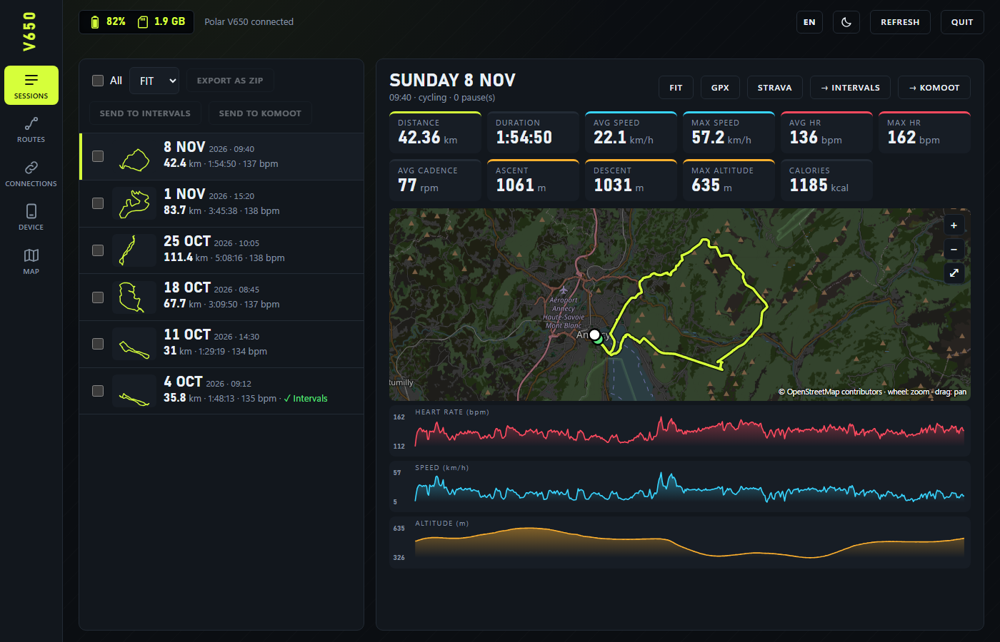
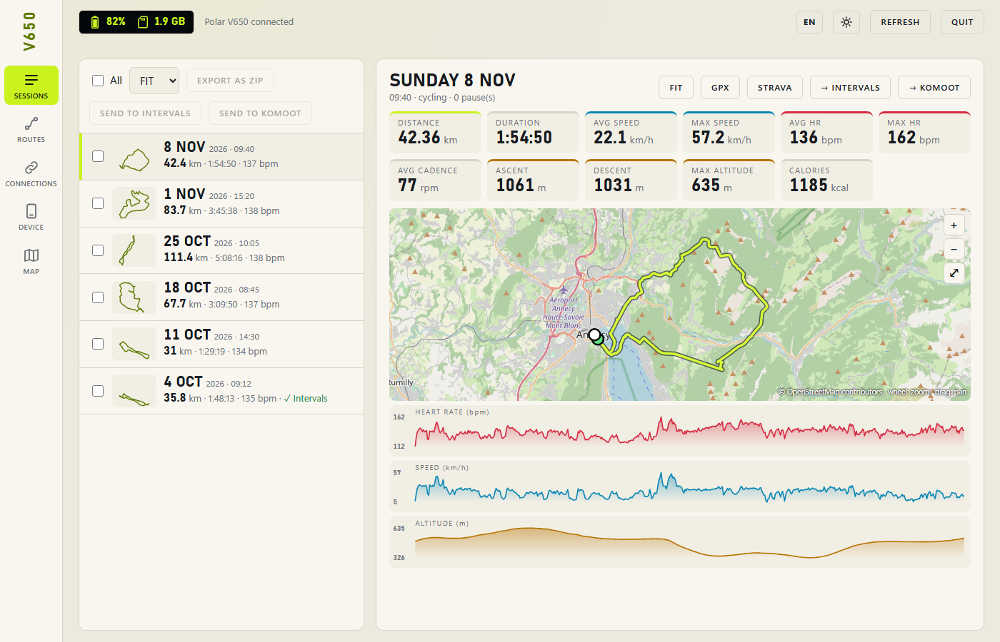
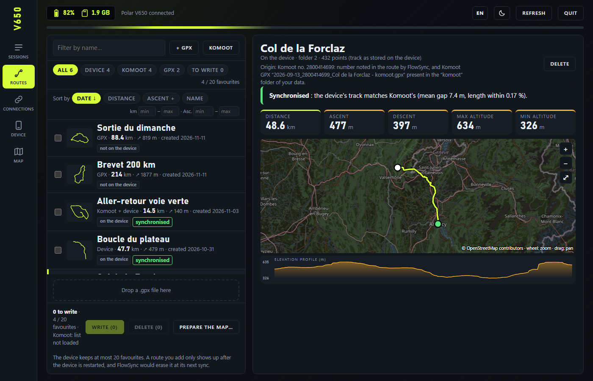
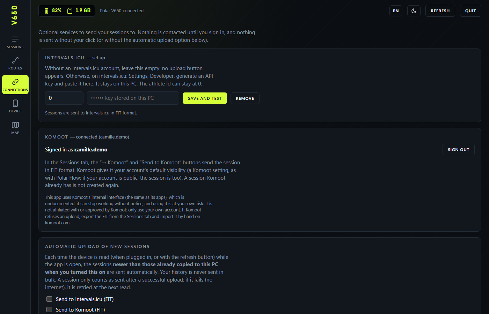
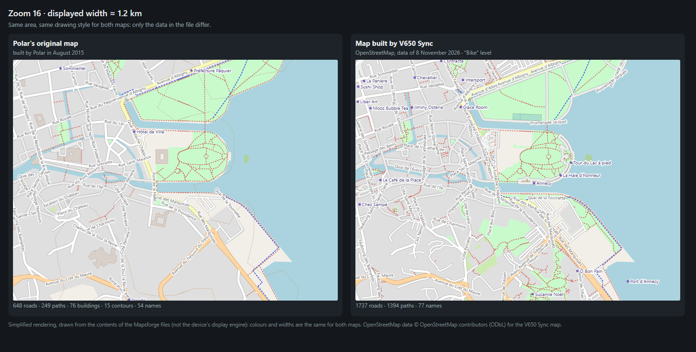
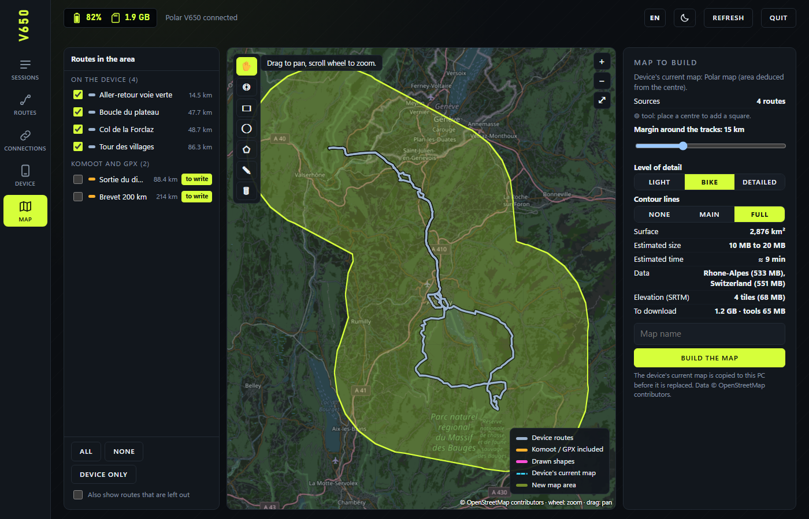

🇫🇷 [Version française](README.fr.md)

# V650 Sync

**Free, unofficial Windows app to sync a Polar V650 bike computer: sessions and routes, with no account and no Bonjour service. As a bonus, it builds up-to-date offline maps.**

V650 Sync is a desktop app for Windows 10 and 11 (a single `.exe` that opens a window). It reads the sessions from the device plugged in over USB, exports them as FIT and GPX, sends them to Intervals.icu and Komoot, manages routes (GPX or Komoot) and, as a second step, builds and installs offline maps from current OpenStreetMap data. The interface is available in English and French, and follows the device's unit setting (km or miles).

> ## ⚠️ Warning: use at your own risk
>
> This application is the result of **unofficial reverse engineering** of the Polar V650 protocol. It **writes to the device's memory** (routes, offline map, clock).
>
> - It has been **tested on a single Polar V650 (firmware 1.5.5), with Windows 11 Pro version 26H2 (build 26300)** only. On another unit, another firmware version or another Windows (Windows 10 included), it may misbehave.
> - It is provided **"as is", without warranty of any kind** (see the GPL-3.0 license, sections 15 and 16).
> - **The authors and contributors accept no liability** for any damage related to its use: data loss, a device that no longer starts or works properly ("bricked"), loss of warranty, or any other harm.
> - The application copies the device to your PC before writing to it, but **there is no automatic restore**: a backup does not guarantee that the device can be put back in its original state.
> - Nothing is written without an action from you (a "Write", "Update" button, etc.), and each one asks for confirmation.
>
> **If you do not accept these terms, do not use this application.**
>
> This project is **independent**: it is not affiliated with, or endorsed by, Polar, Komoot, Strava or Intervals.icu. "Polar", "V650" and "FlowSync" are trademarks of their owners.

## Why

The V650 (2014) only syncs with a PC through **Polar FlowSync**, which depends on Apple's **Bonjour** service: on Windows 10 and 11 it is often missing or refused. I could not get Bluetooth sync with Polar's mobile app to work either. That is where this project comes from: a **more reliable and faster** sync of the device on a current Windows.

That freedom had a side benefit: once the protocol was understood, it also became possible to replace the **offline maps** Polar installs, which date from 2015 (see [below](#offline-maps-a-benefit-of-the-sync-work)).

## Screenshots

The screenshots below use **fictitious data**.

**Sessions**: list with thumbnails, key figures, map and curves (dark theme; a light theme exists too).




**Routes**: device, Komoot and GPX files in a single list, with the "synchronised" status.



**Connections**: Intervals.icu and Komoot (session upload), automatic upload and Strava; the [Device](docs/screenshots/device.png) tab has its own screenshot too.



## What the app does

- **Sessions**: copies the sessions when you plug the device in, shows the detail (track, curves), exports FIT and GPX, and sends them to Intervals.icu and Komoot (manually, or automatically for new sessions if you enable the option; on Komoot, the session gets your account's default visibility).
- **Routes**: a single library for the device's routes, those of Komoot (your account) and your GPX files, with track comparison ("synchronised / not synchronised"), sorting and filters; write, update and delete on the device.
- **Device**: whose device it is (name, Polar e-mail and ID, read from the device and shown on your PC only), battery and free space, the profile stored in the device, and the clock (set to the PC time with one click).
- **Language and units**: English or French (follows Windows by default), and units that follow the device's own setting, independently of the language (English with km and km/h, or French with miles, whichever you use).
- **Update notice**: once a day, a single anonymous request to GitHub tells you whether a newer version exists (a small tag appears at the top). Nothing is downloaded or installed for you, and you can turn it off in the About section.
- **Detailed log** and a one-click bug report (nothing is sent anywhere; passwords, tokens and e-mail addresses are never written to it).
- **Offline maps** (extra): Mapsforge maps built from OpenStreetMap, made to measure (an area drawn in an editor, a band around the chosen routes, Light / Bike / Detailed levels), then written to the device; the shape of the area is respected.

## Offline maps, a benefit of the sync work

The maps Polar installs date from 2015: the cartography is more than ten years old (missing or outdated roads, paths and shops). The app builds up-to-date maps from OpenStreetMap, with the data date displayed.

### Why build your own map

With FlowSync you have no choice: Polar installs **the predefined regional block** that contains the requested area, a fixed grid of **450 km × 450 km** (about 326 MB) with content frozen in 2015. Building your own map changes that:

- **No imposed grid.** The map covers what you decide: bands around the routes planned on the device, a drawn area, a square around a point. You no longer carry 200,000 km² of which you will use a few percent.
- **Lighter.** From a few MB to a few tens of MB instead of ~326 MB: 3.7 MB for 28 × 28 km, about twenty MB for a 15 km band around a 215 km route. It is written to the device in seconds or minutes, and leaves room in its memory.
- **More responsive.** The device has far less data to read and draw: on my device, a map of 8 MB displayed very smoothly.
- **More detailed and up to date.** Roads, paths and names are today's OpenStreetMap ones, with an adjustable level of detail (light, bike, detailed) and, optionally, contour lines.
- **Targeted at your rides.** Before a weekend or a long brevet, a few clicks give you a map that covers exactly the routes you prepared.

**Polar's 2015 map or an up-to-date map, an example** (same data drawn with the same style): the map on the right has noticeably more roads, paths and names; it has no buildings, however (at the "Bike" level), and contour lines are an option (see [the comparison](docs/MAP-COMPARISON.md#with-contour-lines-option)). All zoom levels and details are in [`docs/MAP-COMPARISON.md`](docs/MAP-COMPARISON.md).



**Area editor**: level of detail, estimated size and duration before building.



## Installation

**Ready-to-use version** (Windows 10/11, 64-bit): download `V650Sync.exe` from this repository's *Releases* and double-click it. The release notes give the file's SHA-256 so you can check it:

```powershell
Get-FileHash .\V650Sync.exe -Algorithm SHA256
```

Because the app is not code-signed, Windows SmartScreen may show a blue **"Windows protected your PC"** window. Click **More info**, then **Run anyway**. The full source code is in this repository if you prefer to read or build it yourself.

**From source** (Python 3.12 or newer):

```bash
git clone https://github.com/keltiss38/v650-sync.git
cd v650-sync
lancer.bat
```

`lancer.bat` creates a local Python environment, installs `requirements.txt` and opens the app. To build the exe: `pip install -r requirements-dev.txt` then `pyinstaller v650sync.spec`.

## Usage

1. Turn the device on, then plug it in over USB. On first launch, choose the folder where your data will be kept.
2. The sessions are read automatically. The *Sessions*, *Routes*, *Connections*, *Device* and *Map* tabs do the rest.
3. To **see** a route or map you wrote on the device, **turn the device off and on again**. This is not needed between two writes: you can chain several, then restart once at the end.

Your data (copy of the device, exports, configuration) stays **on your PC**, in the folder you chose. Komoot and Intervals.icu are only contacted if you sign in to them, and GitHub is only contacted for the daily update check (which you can turn off). Passwords are not stored; the Komoot token and the Intervals.icu key are encrypted by Windows (DPAPI).

### Do not run FlowSync at the same time

FlowSync **erases and rewrites all the routes** on the device at every sync (observed): routes added with this app disappear. And if a new map area is requested on the device, FlowSync replaces it with a 2015 Polar map. Use one or the other.

### What is downloaded, and when

The executable does not include the map-building tools (they are heavy). **When you start building a map**, the app downloads, from the official sites and with SHA-256 checks: Java (Eclipse Temurin), Osmosis and its *mapsforge-map-writer* plugin, then the OpenStreetMap extracts from Geofabrik for your area. If you choose **contour lines**, the app also downloads SRTM elevation tiles (public domain, about 17 MB per one-degree square, i.e. ~70 × 110 km) from AWS's "Terrain Tiles" dataset. The build plan first shows what will be downloaded and how big it is; nothing is downloaded at launch or without this action.

## Known limitations

- Tested on a single V650 and on Windows 11; Windows 10 is untested. Windows 7/8 are not supported.
- Access to Komoot goes through an unofficial interface that may change or be restricted without notice. Use only your own account, in moderation.
- The built maps use OpenStreetMap data (© OpenStreetMap contributors, ODbL). The device does not show icons for shops, only their name. It shows a white square around the map (the bounding rectangle of the file); the area itself is exact.
- **Contour lines** ("None / Main / Full" option in the map editor): they are computed from SRTM elevations, with the same marks as Polar's maps. **Their display has been checked on the device**; they are off by default to keep maps light. Accuracy follows that of the SRTM data (about 30 m); on large areas, the computation uses one point out of two or three.
- The English interface is a runtime translation of the French source text: a few rare messages (the first-run folder dialog, native Windows dialogs, the log) stay in French.
- Technical details (protocol, formats, validations) are in [`docs/TECHNICAL-NOTES.md`](docs/TECHNICAL-NOTES.md).

## Contributing

Bug reports are welcome: in the app, *Device* tab → "Create a bug report", then read the ZIP file before attaching it (it may contain route names and file paths). Test feedback on other V650 units, other firmware versions or Windows 10 is particularly useful.

## Transparency: built with Claude

This code was written with the help of **Claude** (Anthropic models, through Claude Code). The decisions, the tests on the device and the validations were done by me, on my own hardware; the code is reviewed and tested (automated tests in `tests/`), but it may contain errors: see the warning above.

## License

Copyright (C) 2026 keltiss

**GNU General Public License v3.0 or later** (see `LICENSE`). You may use, study, modify and redistribute this application; any modified version you distribute must stay under the same license, source code included. Third-party components: see [`THIRD_PARTY.md`](THIRD_PARTY.md).
