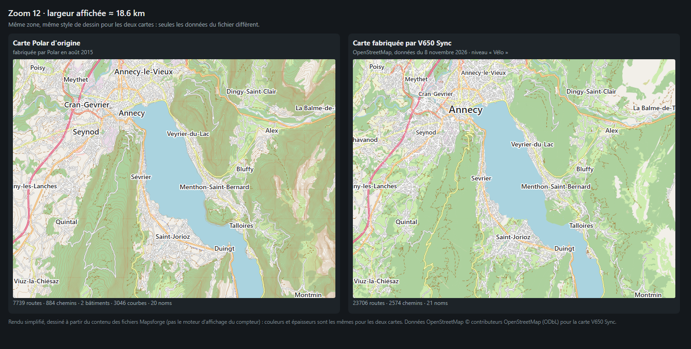
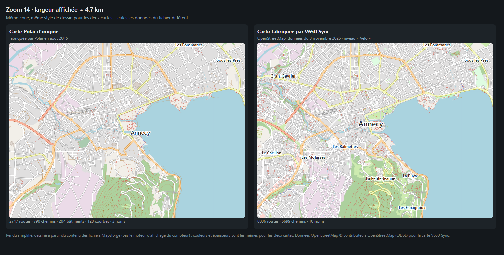
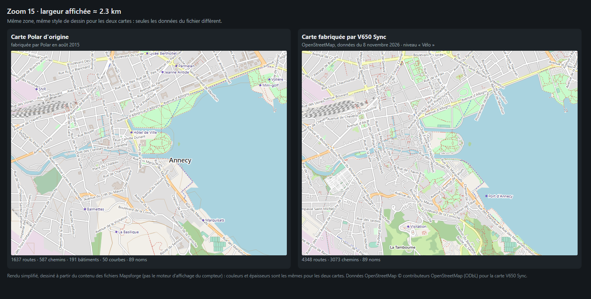
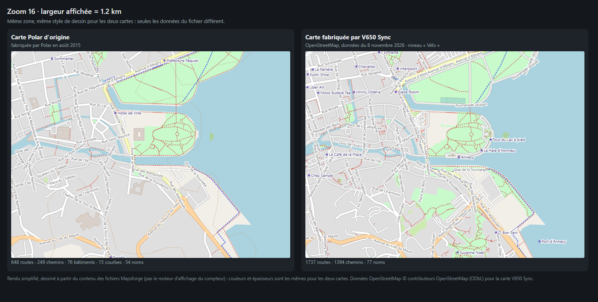
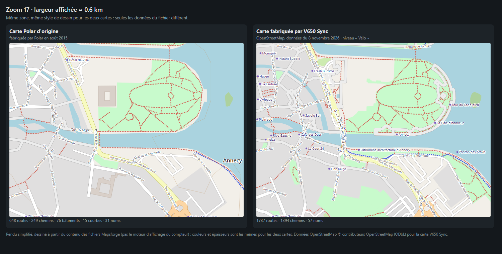
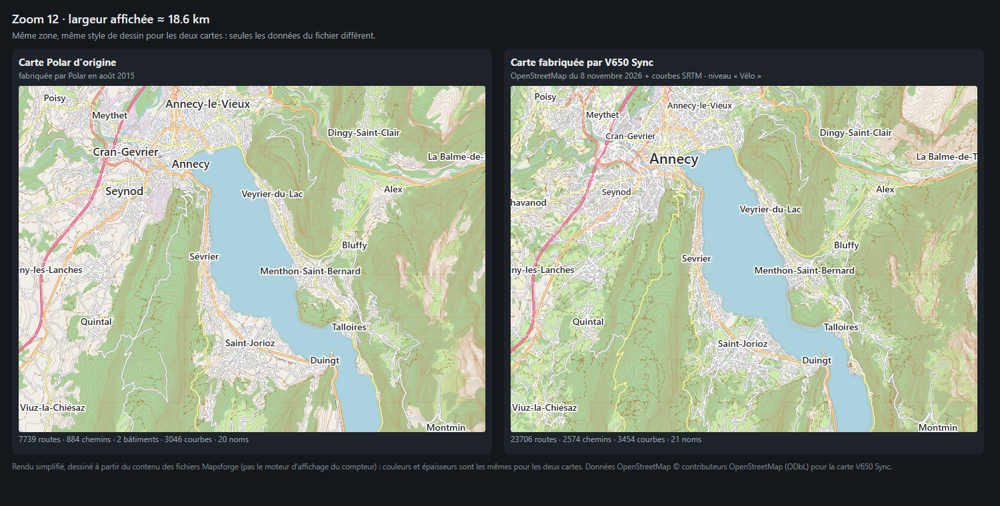

🇬🇧 [English version](MAP-COMPARISON.md)

# Carte Polar d'origine ou carte V650 Sync : ce qui change

Même zone (la ville d'Annecy et son lac, choisie comme exemple), mêmes niveaux de zoom, **même style de dessin** pour les deux cartes : seules les données du fichier diffèrent.

- **À gauche** : la carte hors ligne installée par Polar (bloc régional de ~326 Mo, fabriqué en août 2015).
- **À droite** : une carte fabriquée par V650 Sync pour un carré de 28 km de côté (3,7 Mo), à partir des données OpenStreetMap du 8 novembre 2026, niveau de détail « Vélo ».

> Ces images sont un **rendu simplifié**, dessiné à partir du contenu des fichiers Mapsforge. Ce n'est pas le moteur d'affichage du compteur : les couleurs, les épaisseurs et l'emplacement des noms diffèrent de ce que le V650 montre. Elles servent à comparer les **données**, pas l'apparence exacte sur l'écran du compteur.

## Zoom 12 : l'agglomération (≈ 18 km de large)

## Zoom 14 : le quartier (≈ 4,7 km)

## Zoom 15 (≈ 2,3 km)

## Zoom 16 (≈ 1,2 km)

## Zoom 17 : à l'échelle des aperçus du compteur (≈ 600 m)

## Ce que l'on constate

Éléments dessinés dans la vue (comptés sur les images ci-dessus) :

| Zoom | Routes (Polar → V650 Sync) | Chemins (Polar → V650 Sync) | Bâtiments | Courbes de niveau |
|---|---|---|---|---|
| 12 | 7 739 → 23 706 | 884 → 2 574 | 2 → 0 | 3 046 → 0 (3 454 avec l'option) |
| 14 | 2 747 → 8 036 | 790 → 5 699 | 204 → 0 | 128 → 0 (215) |
| 15 | 1 637 → 4 348 | 587 → 3 073 | 191 → 0 | 50 → 0 |
| 16 | 648 → 1 737 | 249 → 1 394 | 76 → 0 | 15 → 0 (53) |

- **Plus à jour** : les rues, les sentiers et les noms de lieux sont ceux de novembre 2026. La carte Polar a plus de dix ans : les chemins et les commerces récents manquent, et les aménagements ont changé. En ville, la nouvelle carte compte nettement plus de routes et de chemins, et de nombreux commerces et points d'intérêt nommés (au zoom 17 : une soixantaine de noms contre une trentaine).
- **Ce que la nouvelle carte n'a pas (encore)** :
  - **Les courbes de niveau** : la carte Polar en contient. Celles de V650 Sync n'en ont pas, **sauf si vous choisissez l'option** « Courbes de niveau » (voir plus bas). Sans elles, le relief est moins lisible en montagne (zoom 12).
  - **Les bâtiments** : absents au niveau « Vélo » pour garder la carte légère. Le niveau « Détaillé » les ajoute (environ ×1,85 en taille).
- **Apparition des routes selon le zoom** : le zoom à partir duquel chaque type de voie apparaît (nationales dès le zoom 10, routes de desserte, pistes et chemins de terre dès le 12, sentiers et escaliers dès le 13…) est **relevé dans la carte Polar** (`v650sync/mapdata/zoom_polar.json`) et appliqué aux cartes fabriquées. Une version précédente n'affichait ces voies que plus tard : aux petits zooms, des routes manquaient par rapport à la carte Polar.
- **Taille** : 3,7 Mo pour 28 × 28 km, contre ~326 Mo pour le bloc de Polar (450 × 450 km). La fabrication prend une vingtaine de secondes pour cette zone.
- **Le lac** : il s'affiche entièrement ici car il est dans la zone. Au bord d'une zone dessinée, un lac ou une forêt coupés par la limite peuvent perdre leur remplissage (voir « Limites connues » du [README](../README.fr.md)).

## Avec les courbes de niveau (option)

Même comparaison, avec la carte V650 Sync fabriquée **avec toutes les courbes** (une courbe tous les 25 m, calculée à partir des altitudes SRTM). Elle fait 4,3 Mo contre 3,7 Mo sans courbes (+15 %).

**Zoom 12** (≈ 18 km) : le relief du Semnoz, du Parmelan et des montagnes de l'est redevient lisible.

**Zoom 14** (≈ 4,7 km) :

**Zoom 16** (≈ 1,2 km) :

Ce rendu est celui de mon lecteur de cartes. **Le rendu sur l'écran du compteur n'est pas encore vérifié**, d'où l'option désactivée par défaut. Altitudes : SRTM (NASA / USGS, domaine public), via les « Terrain Tiles » d'AWS.

## Comment ces images ont été faites

Un petit lecteur écrit pour l'occasion décode le format Mapsforge version 3 (index de tuiles, balises, tracés de chaque niveau de zoom) et dessine les deux fichiers avec les mêmes couleurs. La carte V650 Sync est celle que l'application produit avec les outils et réglages décrits dans [`NOTES-TECHNIQUES.fr.md`](NOTES-TECHNIQUES.fr.md), pour une zone carrée de 28 km autour de 45,86° N / 6,15° E.

Données de la carte V650 Sync : © contributeurs OpenStreetMap, licence ODbL. Le contenu de la carte Polar suit le même modèle de données OpenStreetMap ; elle est montrée ici sur une petite zone, à titre de comparaison.

