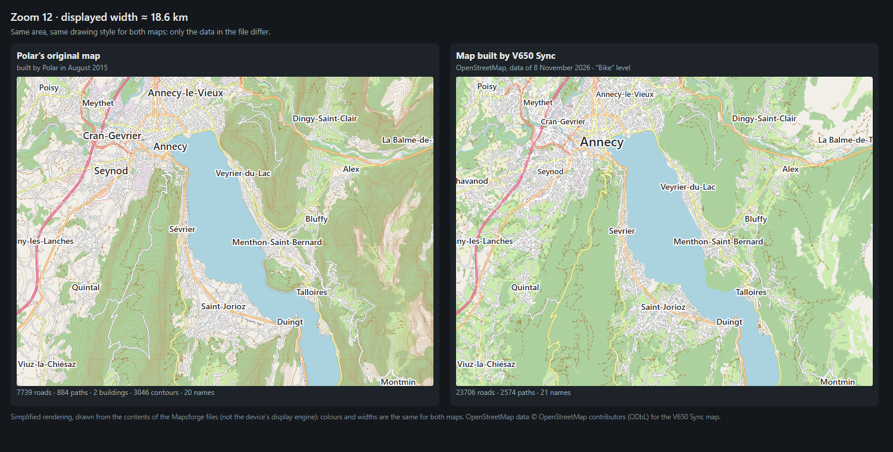
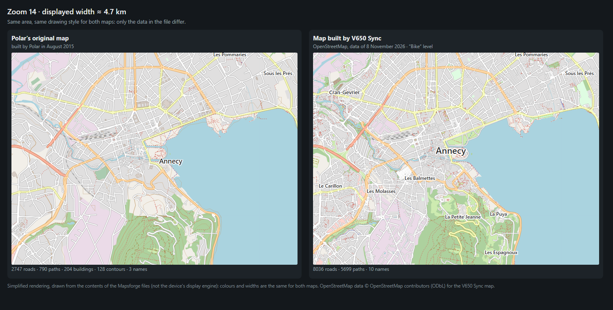
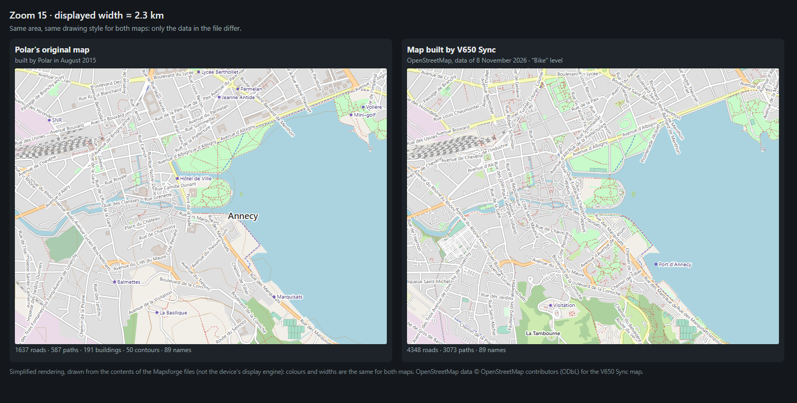
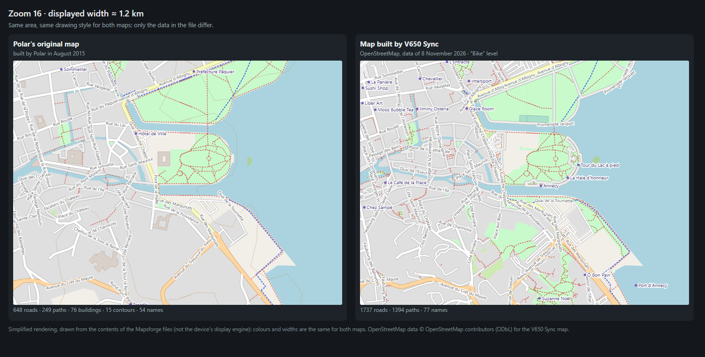
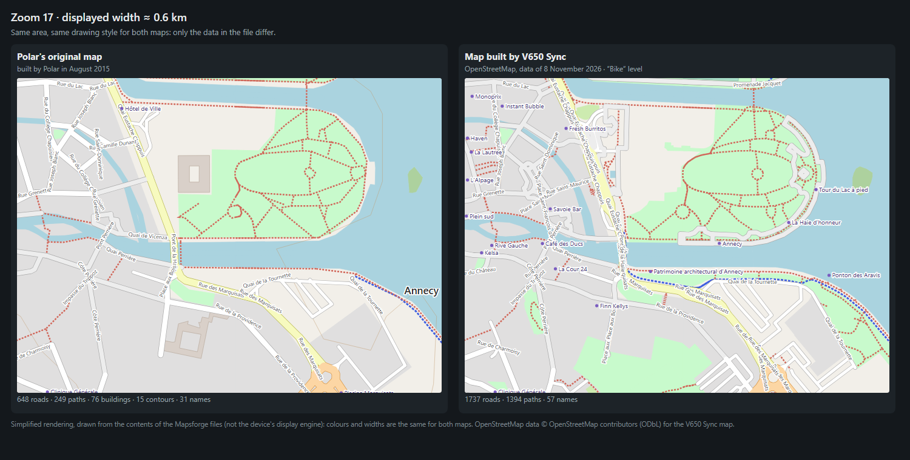
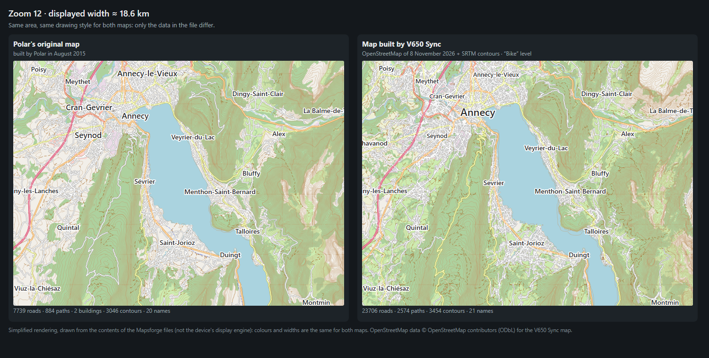
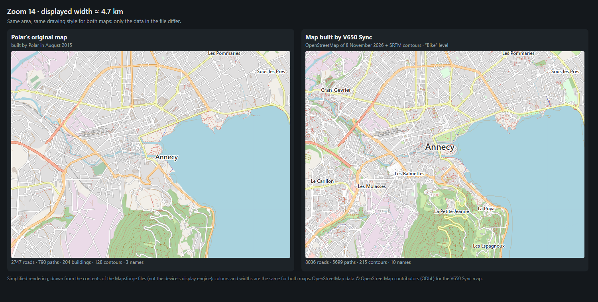
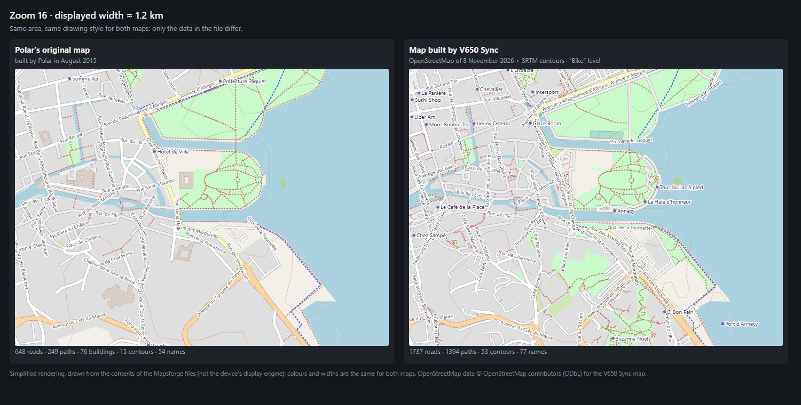

🇫🇷 [Version française](COMPARAISON-CARTES.fr.md)

# Polar's original map or a V650 Sync map: what changes

Same area (the city of Annecy and its lake, chosen as an example), same zoom levels, **same drawing style** for both maps: only the data in the file differ.

- **Left**: the offline map installed by Polar (a regional block of ~326 MB, built in August 2015).
- **Right**: a map built by V650 Sync for a 28 km square (3.7 MB), from the OpenStreetMap data of 8 November 2026, "Bike" level of detail.

> These images are a **simplified rendering**, drawn from the contents of the Mapsforge files. It is not the device's display engine: colours, line widths and label placement differ from what the V650 shows. They are meant to compare the **data**, not the exact look on the device's screen.

## Zoom 12: the urban area (≈ 18 km wide)

## Zoom 14: the neighbourhood (≈ 4.7 km)

## Zoom 15 (≈ 2.3 km)

## Zoom 16 (≈ 1.2 km)

## Zoom 17: the scale of the device's previews (≈ 600 m)

## What we can see

Items drawn in the view (counted on the images above):

| Zoom | Roads (Polar → V650 Sync) | Paths (Polar → V650 Sync) | Buildings | Contour lines |
|---|---|---|---|---|
| 12 | 7,739 → 23,706 | 884 → 2,574 | 2 → 0 | 3,046 → 0 (3,454 with the option) |
| 14 | 2,747 → 8,036 | 790 → 5,699 | 204 → 0 | 128 → 0 (215) |
| 15 | 1,637 → 4,348 | 587 → 3,073 | 191 → 0 | 50 → 0 |
| 16 | 648 → 1,737 | 249 → 1,394 | 76 → 0 | 15 → 0 (53) |

- **More up to date**: streets, trails and place names are those of November 2026. Polar's map is more than ten years old: recent paths and shops are missing, and the layout has changed. In town, the new map has clearly more roads and paths, and many named shops and points of interest (at zoom 17: about sixty names against about thirty).
- **What the new map does not have (yet)**:
  - **Contour lines**: Polar's map has them. V650 Sync's do not, **unless you choose the "Contour lines" option** (see below). Without them, relief is harder to read in the mountains (zoom 12).
  - **Buildings**: absent at the "Bike" level to keep the map light. The "Detailed" level adds them (about ×1.85 in size).
- **When roads appear by zoom level**: the zoom at which each type of road appears (national roads from zoom 10, service roads, tracks and dirt roads from 12, footpaths and steps from 13…) is **read from Polar's map** (`v650sync/mapdata/zoom_polar.json`) and applied to the maps we build. An earlier version only showed these roads later: at low zoom, some roads were missing compared with Polar's map.
- **Size**: 3.7 MB for 28 × 28 km, against ~326 MB for Polar's block (450 × 450 km). Building takes about twenty seconds for this area.
- **The lake**: it displays fully here because it is inside the area. At the edge of a drawn area, a lake or forest cut by the boundary may lose its fill (see "Known limitations" in the [README](../README.md)).

## With contour lines (option)

Same comparison, with the V650 Sync map built **with full contour lines** (one line every 25 m, computed from SRTM elevations). It is 4.3 MB against 3.7 MB without contours (+15 %).

**Zoom 12** (≈ 18 km): the relief of the Semnoz, the Parmelan and the mountains to the east becomes readable again.

**Zoom 14** (≈ 4.7 km):

**Zoom 16** (≈ 1.2 km):

This rendering is the one from my map viewer, not the device's. **The contour lines have been checked on the device itself and display correctly**; the option stays off by default to keep maps light. Elevations: SRTM (NASA / USGS, public domain), via AWS "Terrain Tiles".

## How these images were made

A small viewer written for the occasion decodes the Mapsforge version 3 format (tile index, tags, ways of each zoom level) and draws both files with the same colours. The V650 Sync map is the one the application produces with the tools and settings described in [`TECHNICAL-NOTES.md`](TECHNICAL-NOTES.md), for a 28 km square around 45.86° N / 6.15° E.

V650 Sync map data: © OpenStreetMap contributors, ODbL license. Polar's map content follows the same OpenStreetMap data model; it is shown here on a small area, for comparison.
